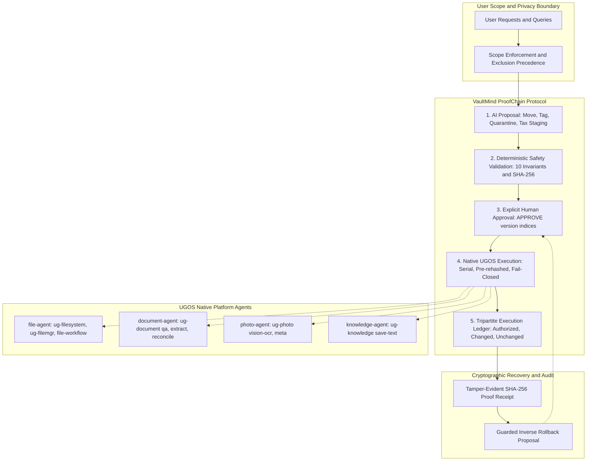

# VaultMind AI

Evidence-backed NAS file answers, explainable smart organization, warranty asset ledgers, tax dossier staging, native OCR, and approval-first SafeAction planning with cryptographic recovery evidence for personal NAS collections.

**Round 1 pre-test Skill, not a NAS-validated release.** The official UGREEN rules permit Markdown orchestration, not custom Python services inside the submitted package. This repository contains the native Skill plus a separate runnable local workbench. Neither local tests nor the official static checker prove device execution.

## Architectural Protocol: VaultMind ProofChain



All mutating or tagging operations follow a unified five-stage lifecycle:
1. **AI Proposal**: Explainable folder organization, zero-trust quarantine, tax dossier staging, or SafeTagging proposals generated with explicit rationales and confidence ratings.
2. **Deterministic Safety Validation**: Preflight verification ensuring canonical path containment, exclusion precedence, absence of symlinks/junctions, no destination collisions, non-circularity, and matching source SHA-256 digests.
3. **Human Approval**: Explicit versioned confirmation tokens (e.g. `APPROVE 3: 0, 1`) binding to the exact plan fingerprint and filesystem state snapshot. Generic confirmations are strictly rejected.
4. **Native UGOS Execution**: Single-use token consumption, preflight source re-hashing, serial one-by-one execution, and immediate halt on first failure.
5. **Verified Execution Receipt**: Structured tripartite execution ledger (Authorized, Actually Changed, Unchanged) with cryptographic SHA-256 proof digests and safely validated inverse rollback proposals.

## Implemented Enhancements

### Critical Features
1. **Warranty & Asset Ledger**: Extracts product details, purchase dates, warranty durations, expiration dates, serial numbers, and citations from receipts and warranty cards. Handles missing serials without hallucination (`serial_status: missing`).
2. **Zero-Trust Quarantine**: Detects credentials, API keys, passwords, and sensitive PII, generating approval-first isolation proposals to restricted quarantine directories with zero secret leakage in logs.
3. **SafeTagging**: Implements native UGOS tagging workflows (`ug-filemgr` `tag-add`, `tag-get-file`) without moving files. Preserves existing tags and guarantees idempotency.
4. **Cryptographic Execution Receipts**: Produces tamper-evident execution receipts with normalized proof hashes and guarded inverse-action proposals.
5. **Collision & Symlink Simulation**: Blocks path collisions, directory traversals (`..`), excluded directory lookalikes, stale authorizations, and unexpected file mutations.

### High-Value Features
6. **Tax Dossier Stager**: Organizes authorized financial documents by year, quarter, and category, detects exact duplicates (via SHA-256) to stage only primary files, and generates audit manifests with prominent statutory non-advice disclaimers.
7. **OCR for Scanned Documents**: Models native `ug-photo:vision-ocr` capabilities to process scanned receipts, preserving character confidence scores, engine provenance, and explicit uncertainty flags for faded or low-contrast text.
8. **Before/After Visualization & ProofChain Workbench**: Interactive local workbench with visual ProofChain progress bar, warranty cards, tax hierarchy viewer, quarantine manager, SafeTagging palette, OCR inspector, and adversarial sandbox.

## Deliverables

- `releases/vaultmind-ai-0.2.0-pretest.zip`: current package; only `SKILL.md` and five directly linked Markdown references. Version 0.1.1 is the prior baseline snapshot.
- `output/pdf/vaultmind-ai-round1-proposal.pdf`: one-page proposal with ten substantive responses.
- `skill/vaultmind-ai/`: editable Skill source, mapped to the official catalog.
- `workbench/`: synthetic search/review interface and deterministic in-memory approval simulator.
- `samples/`: generated synthetic corpus and evaluation labels.
- `artifacts/`: actual checker output, test transcript, benchmark data and release checksums.
- `docs/`: requirements, architecture, installation, evaluation, validation, disclosure and demo materials.

## Run the local workbench

Requires Python 3.12+ with SQLite FTS5. No pip install is needed for the workbench.

```powershell
python tools/generate_samples.py
python -m workbench.server --port 8765
```

Open http://127.0.0.1:8765. The server binds only to loopback and reads the synthetic `samples` corpus. It has no endpoint for arbitrary directories and no operation that moves real files. Simulated state is in memory and resets when the server restarts. Stop with Ctrl+C.

Search is a lexical SQLite FTS5 baseline, not an AI answer or semantic model. Previews are masked source excerpts. Duplicate detection uses SHA-256 and size. Privacy review uses pattern detectors with secret redaction. The Skill uses platform document reasoning; the workbench does not connect to it.

## Reproduce checks

```powershell
python -m unittest discover -s tests -v
python tools/benchmark.py
node vendor/official/uliya-skill-kit/scripts/check-skill.mjs skill/vaultmind-ai
python tools/package_skill.py --version 0.2.0
```

Tests use temporary directories under `tmp/tests`, verify their containment before cleanup, and exercise localhost HTTP. The package builder refuses to overwrite a release with different bytes. It preserves official diagnostics and checks that ZIP content hashes match the checked source.

## Evidence and known limits

Read `docs/EVALUATION.md` for benchmark methodology and `docs/NAS_VALIDATION.md` for remaining device checks. Read `docs/COMPETITION_REQUIREMENTS.md` for citations and the deadline, and `docs/INSTALLATION.md` before attempting NAS setup.

No real user collection was indexed. No file was moved on a NAS. Nothing has been submitted to Devpost or published to SkillHub. Entrant identity, eligibility, authorship review and any team declarations remain the entrant's responsibility.
