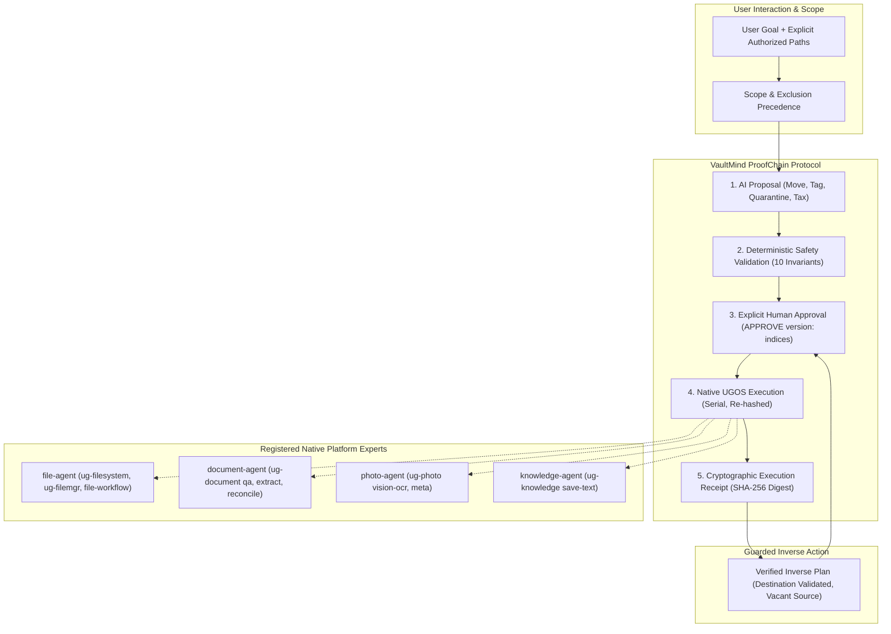

# VaultMind AI Architecture

## Overview

VaultMind AI combines a native Uliya orchestration Skill (`vaultmind-ai`) with an independent, runnable local reference workbench. The design strictly respects the official competition rules: Markdown orchestration through registered platform experts inside the Skill package, with zero unsupported binaries, custom vector databases, or background daemons embedded in the submission ZIP.

## Architectural Requirement: VaultMind ProofChain

The VaultMind ProofChain unifies all mutation and tagging workflows into an unbypassable, tamper-evident protocol:

1. **AI Proposal**:
   - Monotonically incremented session plan version.
   - Plan types: `move`, `tag`, `quarantine`, `tax_stage`, `inverse_rollback`.
   - Each proposed action contains source, destination/tag, current SHA-256 digest, byte size, explicit classification rationale, and confidence rating (`high`, `moderate`, `uncertain`).
   - Ambiguous or uncertain items are segregated into a review list and never auto-staged.

2. **Deterministic Safety Validation**:
   - Rejection of path traversals (`..`), drive colons, backslashes, absolute escapes.
   - Detection and rejection of symlinks, soft links, and directory junctions.
   - Exclusion precedence: excluded paths override inclusions and are pruned prior to discovery or read.
   - Collision checks: destination must be confirmed vacant for moves; overwrites are blocked.
   - Non-circularity: intra-plan dependencies where a destination is also a source are prohibited.
   - Stale source validation: source file size and SHA-256 must match current filesystem state.
   - Deterministic plan fingerprint: SHA-256 digest over normalized plan attributes.

3. **Human Approval**:
   - Approval binds strictly to the exact plan fingerprint and filesystem state snapshot.
   - Requires explicit syntax: `APPROVE <version>` or `APPROVE <version>: <selected_indices>`.
   - Generic affirmations ("yes", "ok", "proceed") are strictly rejected.
   - Issues a time-bounded (300-second TTL), single-use cryptographic grant token.

4. **Native UGOS Execution**:
   - Token consumed immediately to prevent replay attacks.
   - Preflight re-validation: verifies that source files have not been modified or replaced since approval.
   - Serial execution: executes actions sequentially one-by-one.
   - Immediate halt on first failure: stops without continuing unattempted operations.
   - Tripartite outcome ledger:
     * **Authorized**: All actions approved by the user.
     * **Actually Changed**: Verified completed actions with post-execution stat and SHA-256 confirmation.
     * **Unchanged**: Unattempted (halted after prior error), blocked (stale/collision), or failed actions.

5. **Verified Execution Receipt & Inverse Action**:
   - Generates a tamper-evident execution receipt with a cryptographic proof hash (SHA-256 digest of canonical execution summary).
   - Inverse rollback proposals are permitted exclusively for verified items in `actually_changed`.
   - Re-validates that current destination file is unaltered and original source path is vacant.
   - The inverse plan enters the ProofChain as a fresh AI proposal requiring its own explicit approval.

---

## Enhanced Feature Architecture

### 1. Warranty & Asset Ledger
- **Capability Mapping**: `document-agent` `ug-document extract` and `qa`.
- **Extraction Schema**: Product name, manufacturer, model number, serial number, purchase date, purchase price, warranty duration (months/years), expiration date, and citations.
- **Uncertainty & Hallucination Policy**: If a serial number is missing or unstated on a receipt, `serial_status` is explicitly set to `missing` with an uncertainty flag. No serial numbers or warranty durations are hallucinated.

### 2. Zero-Trust Quarantine
- **Capability Mapping**: `document-agent` `ug-document extract` + `file-agent` `ug-filesystem cpmv`.
- **Workflow**: Scans for credentials, API keys, passwords, and sensitive identifiers. Proposes moving flagged documents to an authorized restricted quarantine directory (`archive/quarantine/`).
- **Secret Redaction**: In all preview tables, execution histories, and audit receipts, sensitive values are strictly masked; plaintext secrets are never exposed in logs.

### 3. SafeTagging (Native UGOS Metadata)
- **Capability Mapping**: `file-agent` `ug-filemgr tag-list`, `tag-get-by-name`, `tag-get-file`, `tag-add`, `tag-add-file`, `tag-delete-file`.
- **Workflow**: Categorizes documents by attaching native UGOS metadata tags without moving files.
- **Idempotency Guarantee**: If a tag is already attached, the operation is an idempotent no-op; preserves all other tags on the file. Modifies zero physical bytes.

### 4. Cryptographic Execution Receipts
- **Capability Mapping**: `knowledge-agent` `ug-knowledge save-text` + tripartite execution ledger.
- **Payload**: Normalized receipt containing plan version, plan type, fingerprint, authorized hashes, changed destinations, tripartite counts, and SHA-256 proof hash.

### 5. Collision & Symlink Simulation
- **Safety Invariants**: Enforces 10 adversarial invariants fail-closed: canonical scope containment, exclusion precedence, prefix lookalike prevention, stale source invalidation, collision prevention, explicit versioned approval, action isolation, token replay prevention, cycle/chain rejection, and guarded inverse verification.

### 6. Tax Dossier Stager
- **Capability Mapping**: `document-agent` `ug-document extract` + `file-agent` `ug-filemgr scan-dedupe` + `ug-filesystem cpmv`.
- **Workflow**: Organizes financial documents into `archive/tax/{year}/{quarter}/{category}/` structures. Detects exact duplicates via SHA-256, staging only primary files while flagging duplicates in the evidence manifest.
- **Statutory Notice**: Prominently includes non-advice disclaimer on all reports.

### 7. Native OCR for Scanned Documents
- **Capability Mapping**: `photo-agent` `ug-photo vision-ocr` and `meta`.
- **Workflow**: Transcribes scanned receipts and invoices, preserving engine identifier, timestamp, and character confidence scores. Explicitly flags degraded or faded tokens with uncertainty markers.

### 8. Before/After Visualization & ProofChain Workbench
- **Implementation**: Loopback HTTP server (`workbench/server.py`) with reactive single-page interface (`workbench/ui/`).
- **Features**: Visual ProofChain pipeline bar, asset cards, tax hierarchy viewer, quarantine manager, SafeTagging palette, OCR inspector, and live adversarial sandbox.

---

## Technical Constraints & Boundaries

- **Skill Package Boundary**: Only `SKILL.md` and five Markdown references in `references/`. Checked by the official creation kit (`check-skill.mjs`) with 0 errors and 0 warnings.
- **No Unsupported NAS Runtimes**: No custom Python microservices, embedding stores, SQLite binaries, or background daemons are bundled in the deployable Skill.
- **Reference Simulation vs Hardware Execution**: The local workbench provides an honest in-memory policy reference for testing and demonstration; it does not claim to run native UGOS hardware APIs.
